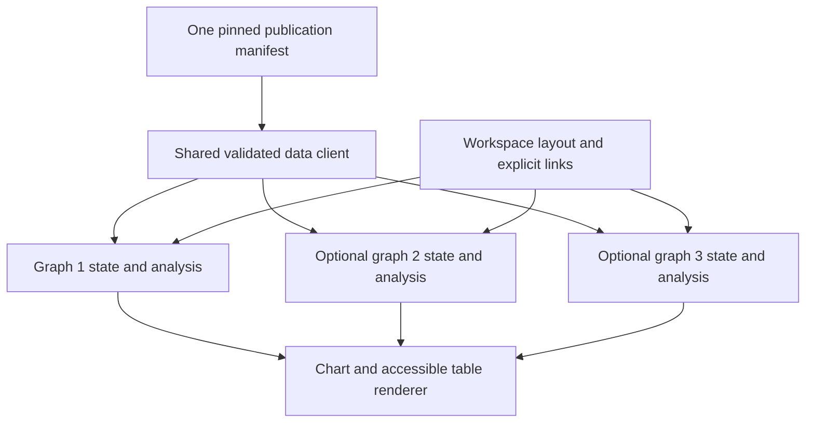

# Idaho weather exploration implementation plan

Status: proposed implementation, November 21, 2026.

Build a polished climate exploration workspace using the existing Idaho archive,
with all reviewed locations and parameters, stronger analytical tools, and
one, two, or three independently configurable graphs. Keep static publication,
explicit provenance, and the distinction between historical reanalysis and live
weather guidance. This document plans the work; it does not ingest data,
change the application, collect weather, train models, or deploy a release.

## 1. Verified starting point

The checkout is on `main` at
`532ea5c60ff58250916262b87084d9465bcab18c`, initially clean for this plan.
The current explorer has daily temperature, annual/monthly statistics,
calendar-day records, year overlays, anomalies, frost, growing-season metrics,
reviewed precipitation, CSV downloads, and browser-local studies. A study
currently opens one saved chart at a time.

Read-only discovery of `~/source/idaho-weather-data/archive/` found:

| Property | Observed result |
| --- | --- |
| CSV files | 21, each representing a distinct coordinate |
| Total CSV size | 1,695,903,321 bytes, approximately 1.58 GiB |
| Schema | Same 32-column header in every file: timestamp, four source metadata fields, 27 weather parameters |
| Endpoint timestamps | First `1980-01-01 00:00:00`, last `2022-12-31 23:00:00`, in every file |
| Sample model identity | `era5` in the first and final records of every file |
| Sample source offsets | UTC−07 for 18 files; UTC−08 for the three northern files |
| Sample availability | Every field populated in the first 48 records of each file |

These checks establish inventory, sample identity and endpoint ranges, not full
continuity, valid ranges, or publication readiness. Full-file validation is
Phase 1. These are multiple location files from the same ERA5/Oikolab source;
they must not be presented as 21 independent observing stations or providers.

The collector scripts contain legacy place names, including Twin Falls, Buhl,
Burley, Murtaugh, Gooding, Ketchum, Emmett, Payette, Moscow, Grangeville and
Coeur d'Alene. Those labels are candidate metadata, not verified geography.
Use the file coordinates as identity; review each label against its coordinate
before publishing it. Keep `twin_falls` stable. An unresolved place name can
appear as a coordinate label rather than block otherwise reviewed data.

Current constraints that affect implementation:

- `configs/stations.yml` contains only Twin Falls. The configured optional raw
  root differs from the available sibling archive.
- `idwx/io.py` currently reads temperature, precipitation and metadata, dropping
  the other weather columns. Merely adding station dropdown options is
  insufficient.
- `idwx/sqlite_store.py` uses a fixed daily schema and a one-source-per-station
  provenance model. The build path is currently designed for one explicit
  station input.
- `idwx/web_export.py` supports station iteration but assumes fixed daily
  metrics and one input mode. Its Parquet fallback currently labels data as
  historical observations; ERA5 imports must retain reanalysis provenance.
- The web data contract is 1.2.0. Exporter, verifier, browser validators,
  package asset allowlists and wheel assets must evolve together.
- `web/js/explorer.js` has one global selection, controller, table and chart
  container. It needs a chart-instance model before multiple graphs work.
- The daily updater deliberately accepts Twin Falls only. The expanded site
  must retain the archive when that updater publishes a refreshed build.

## 2. Product experience

The workspace opens with one graph and a clear **Add graph** button. Adding a
second or third graph keeps the current selection visible and copies it into
the new card as an editable starting point. Three is the workspace limit;
users can keep additional configurations in studies.

Each graph card owns its location, parameter, view, date range, aggregation,
units, baseline and display style. Card actions are Edit, Duplicate, Expand,
Download and Remove. At least one card remains. Removing a card never deletes
a saved study.

A compact workspace toolbar offers presets, layout, link controls and Save
study. It does not force every graph to use the same location or parameter.
Useful starting presets include:

| Preset | Graph 1 | Optional graph 2 | Optional graph 3 |
| --- | --- | --- | --- |
| Compare places | Temperature at location A | Same temperature at location B | Same temperature at location C |
| Growing conditions | Air temperature and freeze threshold | Soil temperature by depth | Soil moisture by depth |
| Water and snow | Monthly precipitation | Snowfall water equivalent | Snow water equivalent on the ground |
| Explore relationships | Temperature timeline | Soil moisture timeline | Paired temperature/moisture scatter |
| Wind and sunlight | Wind speed and gusts | Wind rose | Solar radiation |

Presets choose reviewed metrics actually available at the selected location.
They display a readable explanation, not an implied recommendation about crop
success or irrigation.

### Layout and appearance

Preserve IDWX's recognizable typography and restrained green identity while
redesigning the explorer as a spacious analysis workspace. Use white graph
surfaces, subtle borders, a cooler page background, clear typographic hierarchy,
and muted metadata beneath each title. Use a consistent semantic palette:
green for vegetation/soil context, blue for water, amber for solar radiation,
and a contrasting temperature sequence. Pair color with labels, symbols and
line styles.

- One graph fills the content width.
- Two graphs sit side by side when each has at least 480 CSS pixels; otherwise
  they stack.
- Three graphs default to a full-width primary card above two supporting
  cards. Offer equal columns only when all three meet the same minimum width.
- On phones, stack cards, collapse secondary controls into an accessible edit
  panel, and provide a full-width graph action. Resize axes and tick density;
  do not require horizontal scrolling to understand the chart.
- Put location, metric, unit, period and coverage next to the graph. Group
  uncommon controls under More options, retaining clear access to them.
- Keep loading, unavailable data and error states inside the affected card.
  Use specific messages and a retry action; another graph remains usable.
- Provide visible keyboard focus, touch targets of at least 44 CSS pixels,
  reduced-motion support, accessible inspection and table alternatives.
- Include a searchable location list and a small coordinate map for selection.
  Use points and coverage indicators; do not imply an interpolated statewide
  weather surface.

Create a real-data desktop and mobile design prototype during Phase 2, then
review it before applying the complete redesign. No decorative photos are
needed inside the analysis workspace.

### Linking graphs

Link controls are explicit toggles: date range, location, inspection cursor,
and comparable vertical scale. Dates/cursor can link by default after a graph
is duplicated; location and vertical scale stay independent until selected.

Shared vertical scales require the same physical quantity and compatible
units. Temperature and precipitation never share a numerical scale. If a
linked control conflicts with a view, show why it is unavailable rather than
silently changing the graph's meaning.

A date brush updates linked daily timelines; calendar-year overlays instead
use a month/day cursor. Hourly comparisons default to the same UTC instant,
with the local reporting time shown. A local-hour overlay is a separately
labeled comparison mode. A monthly series can inspect the month containing
a selected day; it must not claim to have a daily value. Unsupported linking
combinations keep their independent selection.

## 3. Parameter catalog and reduction rules

Add a versioned metric registry. Each metric declares its source column,
physical quantity, canonical/display units, height or soil layer, instantaneous
or accumulated meaning, timestamp convention, supported reducers, coverage
rule, chart types and applicable derived analyses. The registry drives both
the publisher and controls; the browser cannot choose arbitrary reducers.

All 27 source parameters are in scope, in the following reviewed groups:

| Group | Source parameters | Daily products and charts |
| --- | --- | --- |
| Air temperature | `temperature`, `dewpoint_temperature` | Minimum, mean, maximum; timelines, calendar records, distributions, year overlays, anomalies |
| Soil temperature | `soil_temperature_level_1` through `_4` | Per-layer minimum/mean/maximum; depth overlays, seasonal heatmaps, threshold runs |
| Soil moisture | `volumetric_soil_water_layer_1` through `_4` | Per-layer mean and extrema, fraction or percent display; timelines, depth profiles, historical percentiles |
| Humidity and clouds | `relative_humidity`, `total_cloud_cover` | Mean and extrema; fraction/percent conversion, timelines, distributions |
| Pressure | `surface_pressure`, `mean_sea_level_pressure` | Mean and extrema; Pa to hPa conversion, separate series with explicit pressure type |
| Wind | `wind_speed`, `wind_direction`, `10m_wind_gust`, `100m_wind_speed`, `100m_wind_direction` | Mean/max speed, maximum sampled gust, wind roses and directional summaries; distinguish 10 m and 100 m |
| Radiation | `surface_thermal_radiation`, `surface_solar_radiation`, `direct_normal_solar_radiation`, `surface_diffuse_solar_radiation` | Reviewed mean flux and daily integrated energy; timelines, seasonal profiles and distributions |
| Precipitation and snow | `total_precipitation`, `snowfall`, `snow_depth`, `snow_density` | Precipitation/snowfall sums, snow-water-equivalent state summaries, snow density statistics; totals, timelines, cumulative curves and seasonal heatmaps |

Registry details:

- Retain Celsius, mm water equivalent, m/s, hPa, W/m², MJ/m² and kg/m³ as
  explicit canonical quantities. Fraction fields stay fractions internally;
  multiply by 100 only for percent display/export fields labeled percent.
- Give soil layers depth labels. Oikolab documents model-dependent depths;
  use the ERA5 layer definitions after verifying the source model.
  [Oikolab parameter reference](https://docs.oikolab.com/parameters/).
- Preserve existing temperature coverage policy for existing published
  products. New daily state statistics initially require all expected hours
  for a complete value; retain valid/expected counts and optional separately
  labeled partial diagnostics. Do not hide differences in method.
- For accumulated precipitation and snowfall, validate whether each hourly
  amount ends at its timestamp and assign the reporting day accordingly.
  Require every expected hourly increment before publishing a complete total.
  Extend the reviewed precipitation method; do not use the legacy heuristic.
- `snow_depth` in these headers is water equivalent. Do not label it physical
  snow depth or sum it across hours. Snow density is a separate state variable.
- Validate radiation interval semantics before integrating flux over time.
  Publish energy only when interval duration and coverage are known. Do not
  assume direct-normal radiation is a disjoint component of horizontal flux
  or add the radiation columns together as total sunlight.
- Direction uses circular/vector methods and matched speed/direction samples.
  Report calm and missing samples separately. A near-zero resultant has no
  reliable mean direction; direction must not be averaged arithmetically.
- Permit mean, min, max, sum, percentiles and cumulative only where meaningful.
  Wind roses need hourly frequencies or preserved directional bin counts,
  not averages of daily directions.

## 4. Data ingestion and storage

Introduce `configs/climate_sources.yml` with an explicit 21-file allowlist,
coordinate identity, display metadata, fixed reporting offset, source adapter,
metric groups and reviewed source fingerprints. Keep raw input roots explicit
and separate from the existing research configuration.

Create a versioned private climate snapshot, for example
`data_cache/climate/<snapshot-id>/`, containing partitioned Parquet datasets,
a metric catalog, source receipts and validation results. Stage a complete
snapshot before promoting its manifest. Treat duplicate timestamps, conflicting
sources, unexpected coordinate/model changes and source modifications during
reading as review failures. Never resolve them by last-file-wins behavior.

Use streaming/chunked reads rather than loading all 1.58 GiB at once. Preserve
reviewed normalized hourly data privately for bounded hourly publications;
compute daily products independently per metric. New locations get full
calendar rows with explicit missing states. Reuse the frost/seasonal functions
only after their required temperature products pass validation.

Keep the existing Twin Falls SQLite input and its updater state authoritative
for its currently published temperature and precipitation. The archive snapshot
supplies additional Twin Falls parameters and other locations. Compare overlap
against the reviewed historical inputs; unexplained differences block replacing
existing values. A newer Twin Falls temperature date does not extend the soil,
wind or radiation coverage beyond their 2022 archive cutoff.

Curated snapshots and raw data remain ignored, private build inputs. Package
reviewed static outputs for deployment; record the snapshot digest and source
receipts so a clean export can be reproduced. Do not commit another large
weather database merely to make the frontend work.

### Reporting calendars

Keep source timestamps in UTC and preserve the fixed offset declared by each
reviewed archive: −7 or −8 hours. IANA timezones are additional display metadata,
not a replacement for the archive's reporting calendar. Confirm whether offsets
vary during full-file audit. A future civil-time product requires its own
23/24/25-hour coverage policy and method version.

Instantaneous variables and hour-ending accumulation variables can have
different day-boundary assignment. Store each metric's date basis. Cross-metric
analyses must reconcile those bases explicitly. Label local reporting-day
comparisons across offsets and offer UTC alignment for hourly comparisons.

## 5. Static publication and updater compatibility

Introduce public schema **2.0.0** for the expanded metric/availability contract.
Preserve verification and browser support for retained 1.0/1.1/1.2 publications;
never rewrite historical release contents. Keep existing public temperature
and frost values compatible in meaning, with migration tests.

Proposed release layout:

```text
data/<release-id>/
  stations.json
  metrics.json
  stations/<station-id>.json
  analytics/<station-id>/index.json
  analytics/<station-id>/daily/<year>.json
  climate/<station-id>/availability.json
  climate/<station-id>/daily/<family>/<year>.json
  climate/<station-id>/summary/<family>.json
  climate/<station-id>/hourly/<family>/<year-month>.json
```

Legacy daily files remain the temperature/frost compatibility input. Family
chunks carry added metrics, per-metric coverage/status, source/method references
and reporting calendars. The availability index includes valid dates,
completeness and source kind for each location/metric, not one global freshness
date. Hourly publications contain reviewed allowlisted values, not raw CSV
copies, private source paths or database files.

The top-level release identity binds every published data file, the metric
registry and method versions. The verifier checks field allowlists, valid
ranges, timestamps, station identity, coverage, summary arithmetic and file
digests. Use explicit supported-version dispatch rather than assumptions that
every version other than the latest has the same shape.

Extend the existing daily publication path to load a pinned climate snapshot
alongside refreshed Twin Falls temperature/precipitation. It still fetches only
the already configured Twin Falls parameters. Every new build includes all
reviewed archive locations and additional parameters; the updater's no-op
identity also includes the climate snapshot and frontend/runtime identity.
If the required archive snapshot is missing or incompatible, preserve the
last successful site rather than publish a reduced site.

Retain one publication lock and atomic promotion/rollback. Deployment readiness
requires a simulated later Twin Falls refresh that leaves the other 20
locations and all archive-only parameters present. Broadening automated data
collection is separate future work; the UI must honestly show the older cutoff.

## 6. Frontend architecture for one to three graphs

Refactor the explorer before adding more global controls:



Suggested modules:

| Module | Responsibility |
| --- | --- |
| `workspace.js` | Graph creation/removal, active card, layouts, linked events, workspace URL state |
| `chart-card.js` | Card-scoped controls, load status, title, chart, inspection, statistics and table |
| `data-client.js` | Manifest pinning, schema validation, request deduplication, bounded cache |
| `metric-catalog.js` | Available locations/metrics, unit/reducer compatibility, availability notices |
| `analysis-worker.js` | Bounded aggregation, rolling windows, distributions and pairwise analysis |
| `studies.js` | Workspace persistence, migration, backup/import and changed-data notices |
| `explorer-charts.js` | Existing SVG renderer plus heatmap, distribution, scatter and wind-rose renderers |

Start by extending existing SVG components and semantic HTML rather than
requiring a frontend-framework migration. Adapt large hourly series using
coverage-preserving level-of-detail data and measured point budgets; keep
canonical analysis and CSV values separate from display decimation.

Each graph has a stable ID and its own request generation. Cancelling one
card's work must not invalidate another card. Deduplicate shared fetches, but
do not abort a shared fetch while another graph still needs it. Cache by
release, station, metric family and time partition, with an explicit memory
limit. Keep all graphs pinned to one publication snapshot; offer an explicit
reload when newer data becomes available.

Old single-graph URLs load as one-card workspaces. Version new workspace URL
state, validate at most three cards, bound encoded input, and use stable
catalog IDs rather than executable expressions. Oversized configurations use
a study JSON backup instead of an unusable share URL.

Migrate `idwx.weather-studies.v1` into a versioned workspace format without
deleting the original until a verified migration succeeds. Existing saved
chart selections become one-card workspaces; new studies preserve all card
settings, linking, layout and notes. Retain saved/current release comparisons.

## 7. Enriched analysis capabilities

Deliver useful questions, not only new chart styles:

| Question | Analysis and interaction |
| --- | --- |
| How do locations compare over the same period? | Same metric across up to three locations, consistent units, optional shared scale and common-overlap summary |
| How unusual was this day/month/season? | Fixed-baseline percentiles, departures, ranked historical years and labeled distributions |
| When did soil warm or conditions stay cold? | Editable threshold and consecutive-day rules; missing dates break runs and invalidate unconfirmed events |
| Was this a prolonged dry or wet period? | Wet-day counts, consecutive dry days, rolling reviewed precipitation and cumulative departures; water equivalent stays explicit |
| How do weather variables move together? | Scatter plot of aligned complete pairs, paired sample count, Pearson/Spearman summaries, filters by month/season |
| Are values changing over decades? | Complete-year trends and changes per decade with explicit period and units; any uncertainty method must account for temporal dependence |
| What did the typical daily cycle look like? | Bounded hourly month view and same-hour climatology, with sample counts and a clear time basis |
| How does the soil profile change? | Four-layer temperature/moisture comparisons with labeled depth and independent coverage |
| Where did wind come from? | Direction/speed frequency rose, calm share, valid sample denominator and threshold controls |

Rolling calculations declare trailing versus centered windows and minimum
coverage. Precipitation cumulative curves stop at a missing increment. Averages
of monthly/annual aggregates use correct weighting rather than averaging
unequal periods indiscriminately. Distributions state whether their samples
are hours, days, months or years.

Cross-variable analysis uses matched timestamps and compatible reporting
windows, never a Cartesian join. Report sample exclusions and overlap. Raw
seasonal cycles can dominate correlations; offer within-month anomalies and
label these as descriptive associations. Do not imply causation or produce
unreviewed significance claims. Trend uncertainty and advanced correlations
follow the basic complete-period views, with independent reference fixtures.

Offer 1991–2020 and 1981–2010 reference periods where coverage supports them,
with the current published baseline retained as a compatibility option.
These are IDWX reanalysis baselines. Official NOAA normals are a separate
station-based product with their own construction methods.
[NOAA Climate Normals documentation](https://www.ncei.noaa.gov/products/land-based-station/us-climate-normals).

Each graph has an analysis drawer, visible coverage, accessible data table,
CSV of canonical values and methods, plus SVG/PNG export with title, units,
period, source and release identity. Workspace export includes all graph
configurations; a printable study report includes the graphs and explanations.

## 8. Implementation sequence and acceptance gates

| Phase | Deliverable | Completion gate |
| --- | --- | --- |
| 1. Source and metric audit | Explicit 21-location manifest; full-file fingerprints, continuity and per-parameter quality reports; reviewed metric registry and names/coordinate labels | Every file accounted for; duplicates/conflicts investigated; unreviewed metrics unavailable rather than silently published |
| 2. Workspace prototype | Real-data design prototype at desktop/mobile sizes; one/two/three graph layout; keyboard controls and link behavior | Add, duplicate, edit, remove and expand work; one graph failure does not break another; visual review confirms readability |
| 3. Climate snapshot | Streaming adapter, normalized hourly partitions, metric-specific daily products and provenance | Independent reference calculations match multiple locations, seasons, offsets and all reducer families; existing Twin Falls values preserved |
| 4. Publication contract | Schema 2.0.0 exporter/verifier, family chunks, availability catalog, portable package and updater composition | Static package passes verification; retained schemas still verify; simulated daily refresh preserves full archive |
| 5. Broad explorer integration | Reviewed locations/27 parameters, compatible controls, shared data cache, plots/tables/CSV | Every location and parameter has at least one correct view; unavailable dates and unsupported reducers are explicit; live weather remains separate |
| 6. Analysis and studies | Rolling/threshold/distribution tools, multi-location comparisons, versioned workspace URLs and study migration | Exact graph/table/CSV parity; old studies/URLs work; reload/backup round trips preserve all three cards |
| 7. Advanced views and release readiness | Reviewed hourly drill-down, wind rose, paired analysis, trend methods, map, exports, performance and visual refinement | Reference fixtures, accessibility/native browser review, measured budgets and full publication rehearsal pass |

Phases 2 and 3 are independent after the registry/interface design; the final
workspace must not depend on unpublished variables to demonstrate its layout.
Ship reviewable increments, while treating all seven phases as the planned
scope rather than dropping the later parameters or optional graphs.

The first implementation increment should complete Phase 1 and introduce the
card-state refactor with existing temperature data. It produces both an honest
data admission report and a visible two/three-graph foundation before expanding
the data contract.

## 9. Verification and performance criteria

Use tests for the changed data semantics and user workflows, with independent
numeric references rather than assertions copied from reducer code.

- Test timestamp duplicates, missing hours, partial boundary days, leap days,
  both fixed offsets, accumulated/state differences, dry zeros, fractions,
  wind wraparound/calm, missing pairs and invalid physical values.
- Include reference months from a northern and southern point, at least one
  snow period and one radiation period. Match complete-period sums/means and
  coverage using a separate `csv`/`datetime` reference implementation.
- Recompute summaries in the verifier and reject incorrect values even when
  checksums have been updated. Validate provenance and source-kind labels.
- Test legacy and expanded manifests, corrupted chunks, mixed release IDs,
  missing snapshots and updater rollback. Package tests exclude raw CSV,
  SQLite, private receipts, source paths and credentials.
- Exercise adding a second/third graph, independent filtering, linked dates,
  duplicate requests, removal during loading, keyboard inspection, individual
  failures, URL/history restoration, study migration/import and exports.
- Visually review real-data layouts at 390, 768, 1280 and 1920 CSS pixels,
  plus browser zoom/reduced motion. Verify native downloads, touch and table
  navigation. A DOM-only run is not visual acceptance.

Initial engineering budgets, to be measured and adjusted with recorded evidence:

| Operation | Initial target |
| --- | --- |
| Default one-year daily graph | At most 1 MB compressed data transferred after shell load |
| Three graphs, typical daily selections | At most 5 MB compressed cold-cache data; no full-state/all-location download |
| Browser data cache | Approximately 64 MB decoded payload budget, excluding bounded render overhead |
| Dense timeline | At most about 2,000 rendered marks per series; coverage gaps retained and display aggregation labeled |
| Long computation | Worker/chunked execution when measured tasks exceed 50 ms on the reference device |
| Cached filter update | Under 250 ms on a recorded reference machine for ordinary daily views |
| Hourly drill-down | Default one month; explicit bounded range, lazy loading and progress for larger exports |

Record compressed and decoded sizes, peak memory, request counts, computation
and render time for one and three graphs on representative desktop/mobile
hardware. Do not claim these targets are current measurements. Remove the
existing chart minimum-width dependency where it causes phone overflow.

## 10. Delivery boundaries and final definition of done

Implementation completes when all reviewed locations and parameters are
selectable, one to three graphs work independently and through supported
links, analyses have explicit methods/coverage, studies preserve the complete
workspace, and static packaging plus daily republication retain the full data
catalog. Every excluded source/metric has a recorded reason and visible
availability state; inventory presence alone does not make it valid.

Production publication follows the existing narrow deployment and rollback
procedure after local acceptance, including a reviewed runtime/snapshot pair
and the shared publication lock. This plan does not authorize changes to other
hosts, vhosts or scheduled collection scope. Continue on `main`, preserve
unexpected work, and record source/config/artifact identities for a release.

New data collection, new forecast models, field-specific fertility/yield or
irrigation recommendations, and account-backed study sharing are outside this
implementation. The planned enrichment uses existing archive data and the
already established Twin Falls refresh inputs.

## Appendix A. Coordinate inventory

These coordinate identities are copied from filenames and sampled source
records. Source labels are retained only as candidates until their coordinate
mapping is reviewed. All have the same observed endpoint timestamp span.

| Latitude | Longitude | Sample reporting offset |
| ---: | ---: | ---: |
| 42.040929 | -114.872226 | -7 |
| 42.136474 | -114.293275 | -7 |
| 42.275969 | -113.895653 | -7 |
| 42.443600 | -112.215600 | -7 |
| 42.463400 | -114.497500 | -7 |
| 42.467900 | -114.152300 | -7 |
| 42.599200 | -114.759000 | -7 |
| 42.635100 | -113.719900 | -7 |
| 42.655600 | -116.851600 | -7 |
| 42.778824 | -113.528056 | -7 |
| 42.875100 | -112.879300 | -7 |
| 42.918000 | -115.955400 | -7 |
| 42.976403 | -114.688651 | -7 |
| 43.343642 | -114.205501 | -7 |
| 43.679833 | -114.355867 | -7 |
| 43.879858 | -116.531095 | -7 |
| 44.042849 | -116.937079 | -7 |
| 45.169153 | -113.827914 | -7 |
| 45.975976 | -116.123625 | -8 |
| 46.694995 | -116.942834 | -8 |
| 47.703796 | -116.757602 | -8 |
